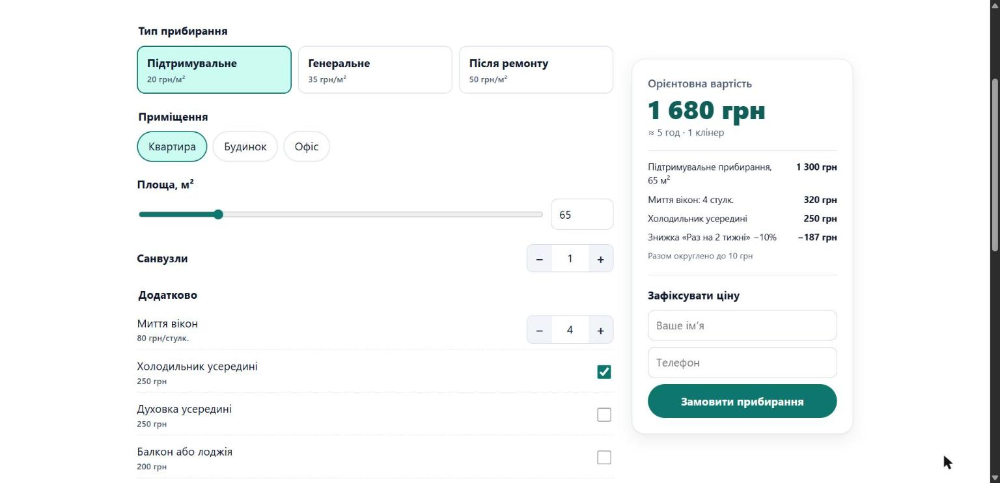

# Калькулятор вартості прибирання

Інтерактивний калькулятор для сайту клінінгової компанії: клієнт обирає тип прибирання, площу й додаткові послуги та одразу бачить ціну, тривалість і кількість клінерів. Чистий JavaScript без бібліотек, плюс плагін для WordPress. Демо-проєкт для портфоліо, ціни умовні.

🌐 **Демо:** https://maksimka22.github.io/cleaning-calculator/
🧹 Пара до сайту [«Чисто Луцьк»](https://maksimka22.github.io/lutsk-cleaning-wp/) ([тема WordPress](https://github.com/MaKsImKa22/lutsk-cleaning-wp))



## Можливості

- **Розрахунок на льоту:** тип прибирання, квартира / будинок / офіс, площа (повзунок і поле), санвузли, 6 додаткових послуг, з яких три мають кількість.
- **Знижки й націнки:** −10% / −15% за регулярне прибирання (лише для підтримувального), +20% за терміновість, мінімальне замовлення.
- **Деталізація:** кожен рядок розрахунку, орієнтовний час і скільки клінерів приїде.
- **Заявка з зафіксованою ціною:** перевірка імені й телефону; розрахунок надсилається разом із заявкою.
- **Мобільна версія:** закріплена внизу смужка з поточною ціною, поки клієнт обирає опції.
- **Доступність:** підписи для всіх полів, керування з клавіатури, ціна оголошується екранним читачам (`aria-live`).
- **Налаштування без зміни коду:** ціни, послуги, знижки й мінімальне замовлення задаються об’єктом конфігурації.


## Як вбудувати на будь-який сайт

```html
<link rel="stylesheet" href="calculator.css">
<div data-cleaning-calculator></div>
<script>
  window.CleaningCalculatorConfig = {
    minOrder: 1000,
    endpoint: '/api/lead' // куди надсилати заявку; без нього — демо-режим
  };
</script>
<script src="calculator.js"></script>
```

Кольори змінюються CSS-змінними `--cc-accent`, `--cc-accent-dark`, `--cc-accent-soft` тощо.

## WordPress

Ця папка — готовий плагін.

1. Заархівуйте папку й завантажте в **Плагіни → Додати новий → Завантажити плагін**, активуйте.
2. Вставте шорткод `[cleaning_calculator]` на будь-яку сторінку.
3. Заявки з калькулятора з’являються в адмінці: у розділі «Заявки» теми «Чисто Луцьк» або в окремому розділі «Заявки з калькулятора» для інших тем. Адміністратор також отримує лист.

Ціни можна змінити фільтром:

```php
add_filter( 'cleaning_calculator_config', function ( $config ) {
	$config['minOrder'] = 1000;
	return $config;
} );
```

Заявки приймаються через `admin-ajax.php` з перевіркою nonce.

## Тести

Логіка розрахунку відокремлена від інтерфейсу і покрита тестами (Node.js 18+):

```bash
node --test tests/
```

## Як я це робив

Зроблено за допомогою AI-асистента Claude Code (vibe coding). Я перевіряв розрахунки вручну, тестував калькулятор у браузері на комп’ютері й телефоні та надсилав тестові заявки в локальний WordPress.

Стек: JavaScript (ES2017, без бібліотек), CSS, PHP, WordPress, node:test.
